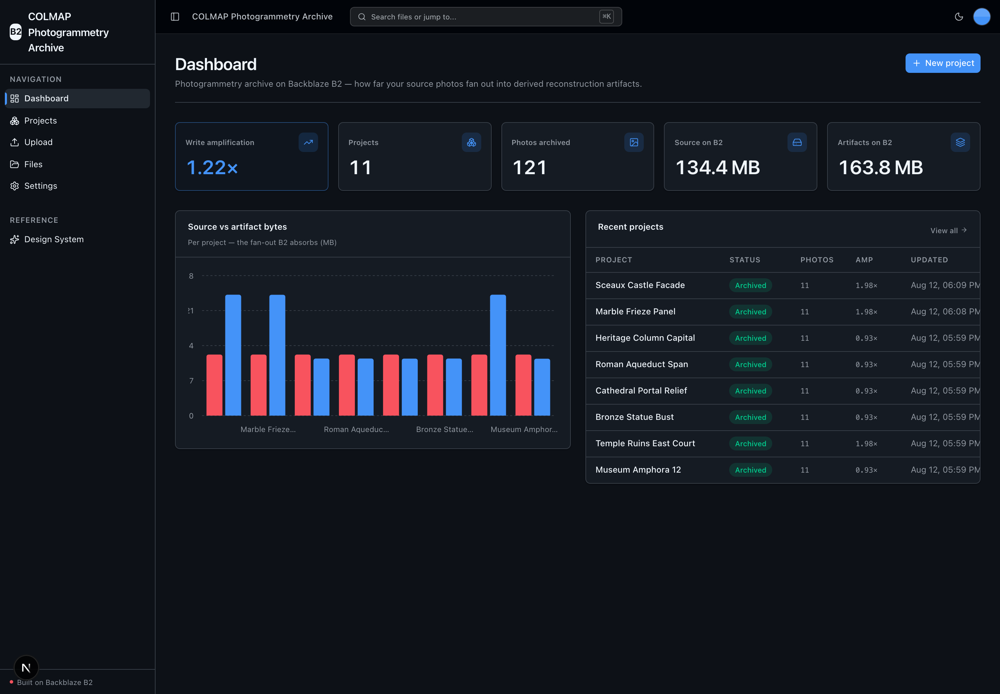
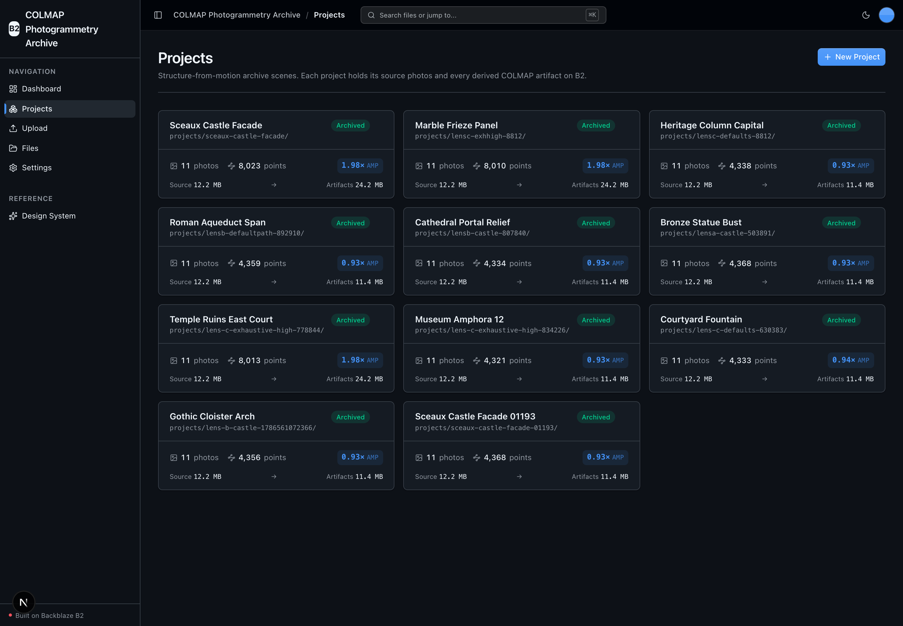
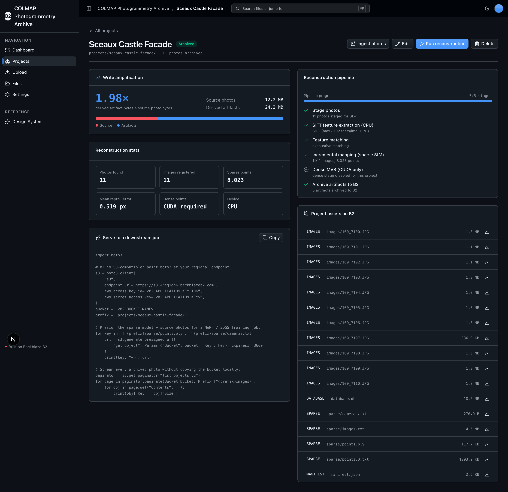

<!-- last_verified: 2026-08-06 -->
# COLMAP Photogrammetry Archive

A full-stack **structure-from-motion (SfM) archive** for photogrammetry studios, film-VFX teams, and cultural-heritage digitization. Create a **Project** (a scene), ingest a set of overlapping photos, run **COLMAP** locally via the official [`pycolmap`](https://github.com/colmap/colmap) bindings to recover camera poses and a sparse point cloud, then **archive every input and derived 3D artifact** — the match `database.db`, the sparse model, `points.ply`, and a per-project `manifest.json` — on **[Backblaze B2](https://www.backblaze.com/cloud-storage?utm_source=github&utm_medium=referral&utm_campaign=ai_artifacts&utm_content=b2ai-colmap-photogrammetry-archive)** over the S3-compatible API.

The headline this sample demonstrates is **write amplification**: a photo set fans out into database + sparse + point-cloud artifacts whose total footprint meets or exceeds the source bytes, and B2 is the single storage layer that holds all of it and serves it back to downstream NeRF / 3D Gaussian Splatting jobs via presigned URLs.

Runs on local OSS only — COLMAP is keyless; the only secret is your B2 credentials.

**What you get out of the box:**
- Full-stack UI (Next.js 16 + React 19 + Tailwind v4 + shadcn/ui) with a **Projects** library, project detail (pipeline timeline, **write-amplification panel**, reconstruction stats, a **project-scoped asset explorer**, and a copyable presigned-serving snippet), and an archive dashboard
- Real COLMAP SfM via `pycolmap` — SIFT extraction (CPU), matching (exhaustive / sequential / spatial), incremental mapping — run in an **isolated worker process** so a native crash can't wedge the API
- **B2 as the sole store** — projects are B2 objects; a per-project `manifest.json` is the canonical artifact index (no database)
- Full-bucket **File Explorer** and drag-and-drop **Upload** kept from the starter (Upload doubles as the project Ingest step)
- FastAPI backend with strict layered architecture and structural tests
- Agent-optimized docs — your AI coding agent can read the repo and start contributing immediately

## What it looks like

**Dashboard** — archive-wide write-amplification, project and photo counts, a per-project source-vs-artifact bytes chart, and the most recent reconstructions.



**Projects** — the library of structure-from-motion scenes, each card showing its B2 prefix, photo and sparse-point counts, and write-amplification ratio.



**Project detail** — per-scene write amplification, reconstruction stats, the COLMAP pipeline timeline, a copyable presigned-serving snippet, and every archived artifact on B2.



## Quick Start

You need: Node.js >= 20, pnpm >= 9, Python >= 3.12, and a free **[Backblaze B2 account](https://www.backblaze.com/sign-up/ai-cloud-storage?utm_source=github&utm_medium=referral&utm_campaign=ai_artifacts&utm_content=b2ai-colmap-photogrammetry-archive)**. No GPU is required — COLMAP sparse SfM runs on CPU (dense MVS is CUDA-only and auto-gated).

```bash
git clone https://github.com/backblaze-b2-samples/colmap-photogrammetry-archive.git
cd colmap-photogrammetry-archive
pnpm run setup
```

`pnpm run setup` copies `.env.example` to `.env` (only when `.env` is missing), installs workspace dependencies from `pnpm-lock.yaml`, creates `services/api/.venv` if missing, validates that an existing venv uses Python 3.12+, and installs the API's committed Python 3.12 resolution (including `pycolmap`) from `services/api/requirements.lock`. It is safe to rerun.

> Use the `pnpm run` form: `setup` (like `doctor`) is a built-in pnpm command before pnpm 11, so bare `pnpm setup` would run pnpm's own command instead of this script.

**Add your B2 credentials.** Open `.env` and, from the [Backblaze B2 dashboard](https://secure.backblaze.com/b2_buckets.htm?utm_source=github&utm_medium=referral&utm_campaign=ai_artifacts&utm_content=b2ai-colmap-photogrammetry-archive):

1. **Create a bucket.** Paste its **Bucket Unique Name** into `B2_BUCKET_NAME`. Set `B2_REGION` to the bucket's region (e.g. `us-east-005`) — the S3 endpoint `https://s3.<region>.backblazeb2.com` is derived from it.
2. **Create an application key** with `Read and Write` permission:
   - **keyID** → `B2_APPLICATION_KEY_ID`
   - **applicationKey** → `B2_APPLICATION_KEY` *(only shown once — paste it now)*

> Walkthroughs: [creating a bucket](https://www.backblaze.com/docs/cloud-storage-create-and-manage-buckets?utm_source=github&utm_medium=referral&utm_campaign=ai_artifacts&utm_content=b2ai-colmap-photogrammetry-archive) and [creating app keys](https://www.backblaze.com/docs/cloud-storage-create-and-manage-app-keys?utm_source=github&utm_medium=referral&utm_campaign=ai_artifacts&utm_content=b2ai-colmap-photogrammetry-archive).

**Run it.**

```bash
pnpm dev
```

Frontend at `localhost:3000`, API at `localhost:8000` (Swagger UI at `/docs`). `pnpm dev` runs the `pnpm run doctor` preflight first — it catches wrong Node/Python versions, a missing venv, missing or placeholder `.env`, and taken ports.

**Try it end to end.** Create a project on `/projects`, open **Upload** (or the project's *Ingest photos* button), drop in a set of overlapping photos, then click **Run reconstruction**. To seed a demo project from your own photos without the UI:

```bash
services/api/.venv/bin/python scripts/seed_demo_project.py --images-dir /path/to/overlapping/photos
```

No imagery is committed to this repo. The seed script ingests photos you point it at (a local folder, or a `--source-url` zip you trust to be CC0 / public-domain — document that provenance yourself); the primary path is uploading your own photos to a project.

### Supported local environments

Local scripts run on macOS, Linux, and WSL2 — native Windows isn't supported yet (the dev scripts use POSIX shell). Reconstruction runs on CPU by default; a CUDA GPU is auto-detected and unlocks the dense MVS stage (Apple MPS is not applicable to COLMAP's CUDA kernels, so on Apple Silicon the pipeline uses CPU). See [docs/dev-workflows.md](docs/dev-workflows.md) for sandbox, port-fallback, and IPv6 behavior.

## When to use

Use this app when you run structure-from-motion over overlapping photo sets and need a durable, queryable archive for every input and derived 3D artifact — with B2 as the single storage layer and presigned URLs serving the artifacts back to downstream NeRF / 3D Gaussian Splatting jobs. It is also a worked example of running a native OSS workload (`pycolmap`) safely inside a layered FastAPI backend, with the whole artifact lifecycle indexed by a manifest on B2.

## When not to use

Do not choose this expecting a hosted, multi-tenant SaaS or a managed reconstruction service. It ships no user accounts, authentication, tenant isolation, or billing, and the API is unauthenticated and bucket-wide by default. Dense MVS and downstream NeRF / 3DGS *training* need a CUDA GPU and are out of scope here (the sample archives the sparse model + inputs for those jobs to consume). You own product-specific security, operations, capacity, and compliance for anything you adapt.

## Why Backblaze B2?

[Backblaze B2](https://www.backblaze.com/cloud-storage?utm_source=github&utm_medium=referral&utm_campaign=ai_artifacts&utm_content=b2ai-colmap-photogrammetry-archive) is the object storage this app is built around — a deliberate default for a workload whose whole point is that it *amplifies* data:

- **S3-compatible API.** B2 speaks the S3 API, so the `boto3` calls and tooling you already use for AWS S3 work unchanged — you just point them at B2's regional endpoint. All storage access is isolated in `services/api/app/repo/`.
- **Built for the fan-out.** A reconstruction turns a photo set into database + sparse + (on CUDA) dense artifacts that can exceed the source bytes. B2's low storage price and generous free egress to compute/CDN partners is what you want when every project multiplies its own footprint and gets streamed to downstream jobs.
- **Free to start.** A [free B2 account](https://www.backblaze.com/sign-up/ai-cloud-storage?utm_source=github&utm_medium=referral&utm_campaign=ai_artifacts&utm_content=b2ai-colmap-photogrammetry-archive) is enough to run everything here.

## Core Features

- [Projects](docs/features/projects.md) — the primary entity, with full create / read / edit / delete / run and a project-scoped asset explorer over the B2 manifest
- [Reconstruction pipeline](docs/features/reconstruction-pipeline.md) — COLMAP stages, matcher modes, CPU-default / CUDA-gated dense, isolated-worker crash isolation
- [Write amplification](docs/features/write-amplification.md) — the headline metric: source photo bytes vs derived-artifact bytes and the ratio B2 absorbs
- [File Upload](docs/features/file-upload.md) — drag-and-drop presigned upload; targets a project's ingest prefix or the generic path
- [File Browser](docs/features/file-browser.md) — full-bucket list, preview, download, delete
- [Dashboard](docs/features/dashboard.md) — projects, photos archived, source/artifact bytes, and the overall write-amplification ratio
- [Metadata Extraction](docs/features/metadata-extraction.md) — image dimensions, EXIF, and checksums for ingested photos
- [Design System](docs/design-system.md) — tokens, primitives, loader, and inline `ErrorState` / `EmptyState` patterns. Live preview at `/design`.
- Checked local API contract — [`docs/api/openapi.json`](docs/api/openapi.json) plus `pnpm contract:check` catch FastAPI/client route drift
- Structural tests — layering rules, import boundaries, `boto3`/`pycolmap` containment in `repo/`, and 300-line file limits
- `/health` (B2 connectivity) and `/metrics` (Prometheus counters) endpoints; structured JSON logging with `request_id`

## Tech Stack

- TypeScript, Next.js 16, React 19, Tailwind v4, shadcn/ui, Recharts, TanStack Query
- Python 3.12+, FastAPI, boto3, Pydantic v2
- **COLMAP via `pycolmap`** (COLMAP's own Python bindings), NumPy, Pillow, plyfile, imageio
- Backblaze B2 (S3-compatible object storage) — the sole datastore
- pnpm workspaces (monorepo)

## Commands

| Command | What it does |
|---------|-------------|
| `pnpm run setup` | One-time cold start: copy `.env.example` → `.env` (only if missing), install workspace deps, create the backend venv, install locked API deps (incl. `pycolmap`) |
| `pnpm dev` | Start frontend + backend (runs the `pnpm run doctor` preflight first) |
| `pnpm verify` | Credential-free pre-PR suite — runs `pnpm check:agent-docs`, `pnpm verify:api`, then `pnpm verify:web` |
| `pnpm verify:full` | `pnpm verify` plus Playwright E2E; needs a live local stack, real `.env`, free port 3000, and Chromium |
| `pnpm contract:export` / `pnpm contract:check` | Export / verify the FastAPI OpenAPI contract in `docs/api/openapi.json` |

`pnpm verify` is the gate to run before opening a PR. It needs `services/api/.venv` from `pnpm run setup`, but no B2 credentials or browser, and it breaks down into `pnpm verify:api` (backend lint, tests, structure), `pnpm verify:web` (frontend lint, unit tests, typecheck + build), and `pnpm check:agent-docs` (agent-doc drift).

For the full command reference (`dev:web`, `dev:api`, `lint`, `test:*`, `check:structure`, `test:e2e`, live B2 tests) plus worktree/parallel-run, port-fallback, and slow-run notes, see [docs/dev-workflows.md](docs/dev-workflows.md).

## Deploying to Vercel

The Next.js web app and FastAPI API deploy as **one Vercel project** sharing one origin (web at `/`, API under `/api`), so there's **no CORS and no second URL to wire up**.

[](https://vercel.com/new/clone?repository-url=https%3A%2F%2Fgithub.com%2Fbackblaze-b2-samples%2Fcolmap-photogrammetry-archive&project-name=colmap-photogrammetry-archive&env=B2_APPLICATION_KEY_ID,B2_APPLICATION_KEY,B2_BUCKET_NAME,B2_REGION&envDescription=B2%20credentials%2C%20bucket%2C%20and%20region&envLink=https%3A%2F%2Fgithub.com%2Fbackblaze-b2-samples%2Fcolmap-photogrammetry-archive%2Fblob%2Fmain%2Finfra%2Fvercel%2FREADME.md)

Set your B2 credentials, bucket, and region and you're live. Ingest uploads go **directly from the browser to B2** (presigned PUT), so Vercel's 4.5 MB payload limit doesn't apply. Two caveats specific to this app:

- **Reconstruction is CPU-heavy and long-running.** COLMAP SfM is best run on a self-hosted API (a machine with real CPU, or a CUDA GPU for dense MVS) rather than a short-lived serverless function. A Vercel deploy is ideal for browsing the archive and ingesting photos; point it at a self-hosted API for production reconstruction.
- The deployed API is unauthenticated and bucket-wide — use a dedicated B2 bucket/prefix and key for any preview, and make sure the bucket's CORS allows the deploy origin.

Full setup — variable reference, the two-Projects alternative, security, and rollback — is in the [Vercel delivery contract](infra/vercel/README.md).

## Documentation Map

| Doc | Purpose |
|-----|---------|
| [AGENTS.md](AGENTS.md) | Agent table of contents — start here |
| [ARCHITECTURE.md](ARCHITECTURE.md) | System layout, layering, data flows |
| [docs/features/](docs/features/) | Feature docs (projects, reconstruction, write amplification, upload, browser, dashboard, metadata) |
| [docs/app-workflows.md](docs/app-workflows.md) | User journeys |
| [docs/dev-workflows.md](docs/dev-workflows.md) | Engineering workflows and testing |
| [docs/SECURITY.md](docs/SECURITY.md) | Security principles |
| [docs/RELIABILITY.md](docs/RELIABILITY.md) | Reliability expectations |
| [docs/api/openapi.json](docs/api/openapi.json) | Checked contract for the app's local FastAPI API |
| [infra/vercel/README.md](infra/vercel/README.md) | Vercel deployment contract |
| [docs/exec-plans/](docs/exec-plans/) | Execution plans and tech debt tracker |

## FAQ

**What does COLMAP Photogrammetry Archive do?**
It lets a team create a Project, ingest overlapping photos to Backblaze B2, run COLMAP structure-from-motion locally (via `pycolmap`) to recover camera poses and a sparse point cloud, and archive every input and derived artifact under the project's B2 prefix — indexed by a `manifest.json`. It surfaces the write-amplification ratio (derived-artifact bytes ÷ source photo bytes) and serves artifacts back to downstream jobs with presigned URLs.

**Do I need a GPU?**
No. Sparse SfM (SIFT extraction, matching, incremental mapping) runs on CPU. Dense MVS is CUDA-only and auto-gated: on a CUDA host it runs; otherwise the dense stage is cleanly skipped and the sparse model is archived for GPU jobs. Apple MPS is not applicable to COLMAP's CUDA kernels, so Apple Silicon uses the CPU path.

**Where is project data stored?**
Entirely in your B2 bucket. There is no database — each project is a `projects/<slug>/manifest.json` object, and that manifest is the canonical index of the project's photos and artifacts.

**Is it free?**
The code is MIT-licensed (see [License](#license)) and Backblaze B2 offers a free account. COLMAP runs on-device, so a reconstruction costs nothing beyond your own compute.

**Can I use it in production?**
It's a sample Backblaze maintains to help developers build on B2. Production use is possible with caution and your own validation — you own the security, operations, capacity, and compliance decisions for anything you adapt, and the repository software carries no SLA. See [When not to use](#when-not-to-use).

**Do I have to use Backblaze B2?**
It integrates B2 through the S3-compatible API and B2 is the storage the app is built around. You supply your own bucket and application key during setup.

**How do I rebrand it?**
Edit `apps/web/src/lib/app-config.ts` (`APP_NAME`, `APP_DESCRIPTION`) — the page title, sidebar, and API title all derive from it.

**Where do I get help or report bugs?**
Report repository defects through [GitHub Issues](https://github.com/backblaze-b2-samples/colmap-photogrammetry-archive/issues). For B2 account, billing, service, or API help, use [Backblaze Support](https://www.backblaze.com/help?utm_source=github&utm_medium=referral&utm_campaign=ai_artifacts&utm_content=b2ai-colmap-photogrammetry-archive).

## Maintenance and support

Backblaze maintains this open-source sample to help developers build on B2. Production use is possible with caution and requires your own validation. Report repository defects and feature requests through [GitHub Issues](https://github.com/backblaze-b2-samples/colmap-photogrammetry-archive/issues); for B2 account, billing, service, or API help, use [Backblaze Support](https://www.backblaze.com/help?utm_source=github&utm_medium=referral&utm_campaign=ai_artifacts&utm_content=b2ai-colmap-photogrammetry-archive). This sample is not covered by the Backblaze service level agreement, and no SLA is provided for the repository software; any B2 service or support commitments are governed separately by the applicable Backblaze terms and support plan.

## Contributing

Start with [AGENTS.md](AGENTS.md). It's the map — everything else is discoverable from there. For local commit hooks, follow [the pre-commit workflow](docs/dev-workflows.md#pre-commit).

## License

MIT License - see [LICENSE](LICENSE) for details.

## Related projects

**Claude Agent B2 Skill** — manage Backblaze B2 from your terminal using natural language (list/search, audits, stale or large file detection, security checks, safe cleanup). Repo: [claude-skill-b2-cloud-storage](https://github.com/backblaze-b2-samples/claude-skill-b2-cloud-storage).
